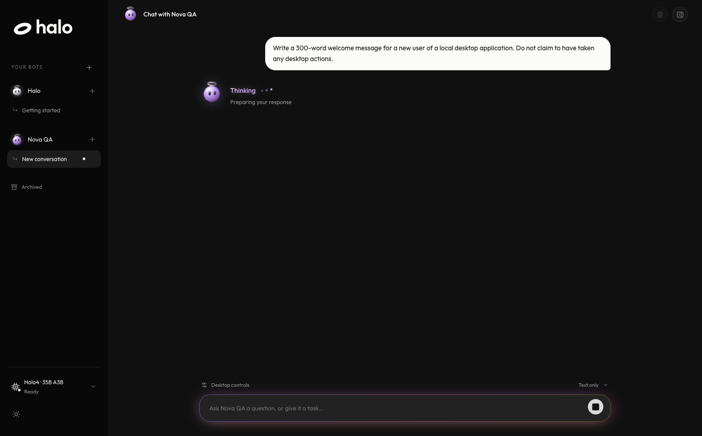
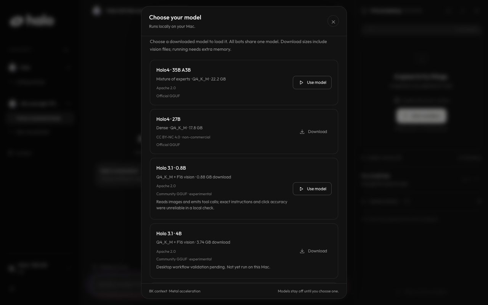
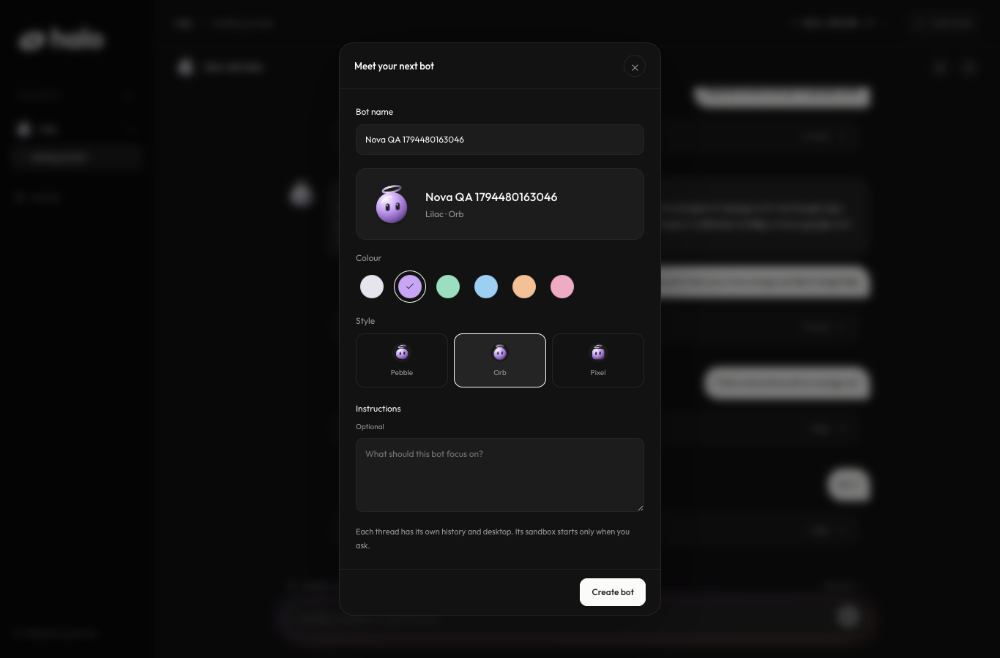

<div align="center">
  <picture>
    <source media="(prefers-color-scheme: dark)" srcset="docs/design/halo-brand-pack/svg/halo-lockup-white.svg">
    <source media="(prefers-color-scheme: light)" srcset="docs/design/halo-brand-pack/svg/halo-lockup-black.svg">
    
  </picture>
  <p>A local AI assistant with its own desktop.</p>
  <p>Apple silicon · Local models · Native Mac app</p>
  <p><a href="#get-started">Get started</a> · <a href="docs/guide.md">Operating guide</a> · <a href="docs/convex-architecture.md">Architecture</a> · <a href="TODO.md">Roadmap</a></p>
</div>



Halo runs H Company's Holo models on your Mac through llama.cpp and Apple Metal.
Chat with your bots, give them saved memory, and let them work in a separate Linux desktop.
The app stores conversations locally with Convex.

## What you can do

- Create named bots with their own instructions, saved memory, avatar colour, and style.
- Keep separate conversation threads and return to them after restarting the app.
- Download, load, switch, and unload local models from the sidebar.
- Give a bot a disposable desktop with optional web access.
- Review each desktop action or enable automatic approval for that sandbox.
- Share desktop screenshots in chat and save them as PNG files.
- Use private login forms with optional macOS Keychain storage.

## A closer look

<table>
  <tr>
    <td width="50%"></td>
    <td width="50%"></td>
  </tr>
  <tr>
    <td align="center">Choose a model that fits your Mac.</td>
    <td align="center">Give each bot its own name and appearance.</td>
  </tr>
</table>

Screenshots show the local development app with test bots.

## Get started

You need an Apple silicon Mac, Node.js 22.13 or later, and [llama.cpp](https://github.com/ggml-org/llama.cpp).
Install llama.cpp with Homebrew if it is not already available.

```sh
git clone https://github.com/rk68/local-computer-use.git
cd local-computer-use
brew install llama.cpp
bash scripts/poc.sh setup
bash scripts/poc.sh
```

Open **http://127.0.0.1:8765**.
Use the model control at the bottom of the sidebar to choose and load a model.
Models and sandboxes stay off until you request them.
The first model download can be large.

### Open as a Mac app

After setup, build and open the native wrapper.

```sh
bash scripts/build-macos.sh
open artifacts/Halo.app
```

The Mac app uses Swift, AppKit, and WebKit around the same React interface.
It starts the local workspace when needed.
This local build requires the checkout and its dependencies.
Rebuild it if you move the project or change the Node.js executable.
It is ad hoc signed and is not a notarized standalone distribution.

## Models

| Model | Download including vision projector | Status |
| --- | ---: | --- |
| Holo4 35B A3B | 22.2 GB | Default |
| Holo4 27B | 17.8 GB | Non-commercial use |
| Holo 3.1 0.8B | 0.88 GB | Experimental community conversion |
| Holo 3.1 4B | 3.74 GB | Experimental community conversion |
| Holo 3.1 9B | 6.55 GB | Experimental community conversion |

Running a model needs more memory than its download size.
The Holo 3.1 conversions have limited desktop validation.
The model picker shows the source, licence, and known limits for each entry.
See the [model setup notes](docs/guide.md#start-halo) for file verification and manual server use.

## How it runs

| Part | Stack |
| --- | --- |
| Interface | React, TypeScript, Vite |
| Local data and agent runs | Convex and the Convex Agent component |
| Desktop executor | Node.js, TypeScript, Cua, QEMU |
| Model inference | llama.cpp with Apple Metal |
| Mac window | Swift, AppKit, WebKit |

The normal app runtime does not require Python.
The original Python implementation remains as a regression reference.

## Local data and desktop access

- The app and Convex bind to loopback addresses.
- The sandbox controls a separate Linux VM. It does not control your Mac or mount host folders.
- New sandboxes have no outbound network access unless you enable it.
- Saved memory is explicit and belongs to one bot. Halo does not extract it automatically.
- Private login fields bypass chat and model requests. Optional saved accounts use macOS Keychain.
- Enabling web access lets the sandbox contact external websites.

Private-field masking and URL filtering have limits.
Use demo accounts until you review the [private login notes](docs/guide.md#private-login) and [live validation results](docs/overnight-briefing-2026-11-12.md).

## Development

```sh
npm test --prefix runtime
npm run check --prefix runtime
npm run build --prefix web
web/node_modules/.bin/tsc --noEmit -p web/convex/tsconfig.json
```

See the [operating guide](docs/guide.md) for browser checks, sandbox cleanup, model diagnostics, and screenshot tests.
The [architecture guide](docs/convex-architecture.md) describes service boundaries.
The [roadmap](TODO.md) tracks remaining work, including collaboration between bots.

## Project notes

- [Operating guide](docs/guide.md)
- [Latest implementation briefing](docs/overnight-briefing-2026-11-12.md)
- [Halo brand assets and font licence](docs/design/halo-brand-pack/README.md)
- [Holo4 model card](https://huggingface.co/Hcompany/Holo4-35B-A3B-GGUF)
