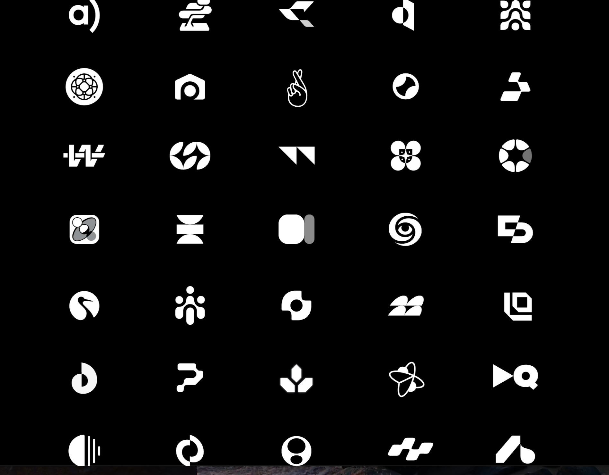
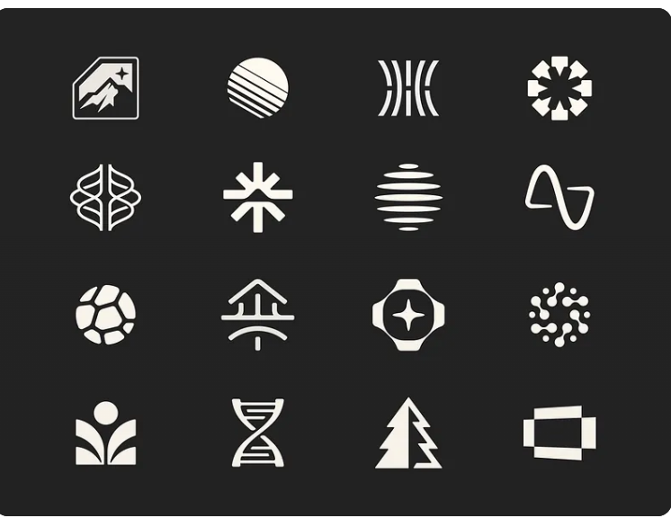
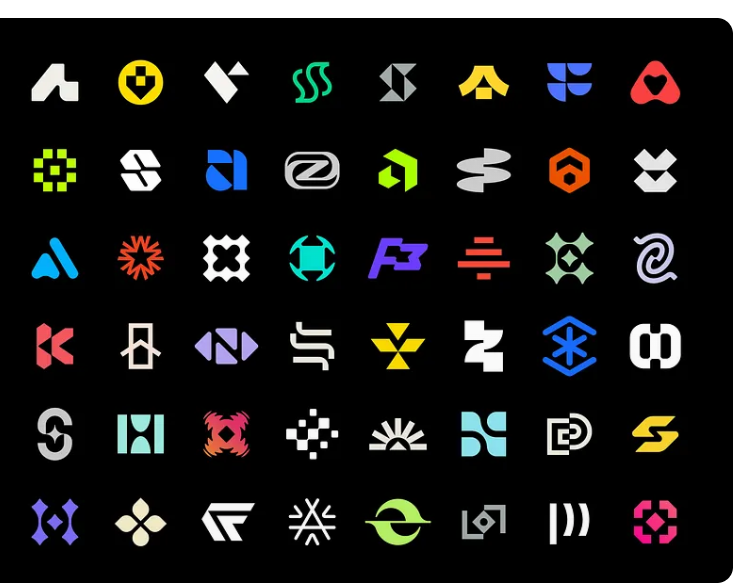
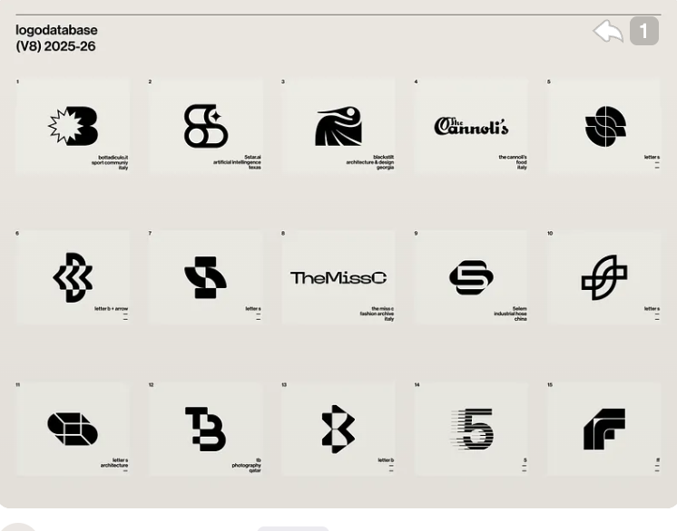
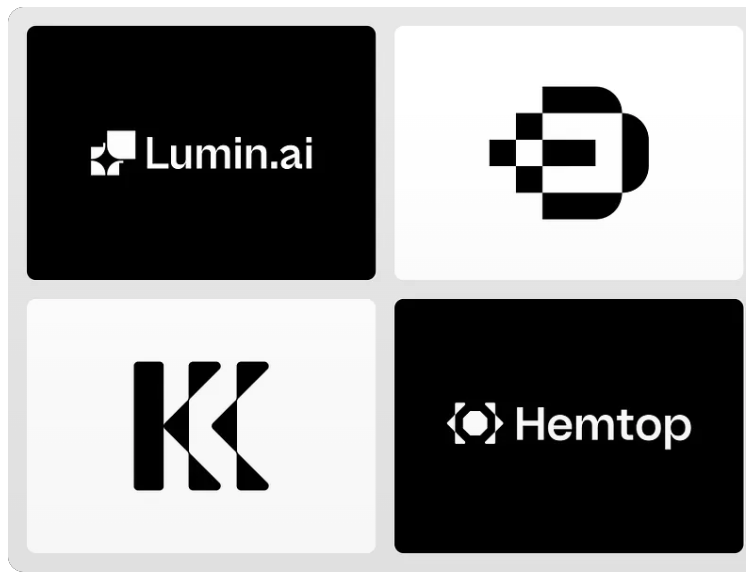
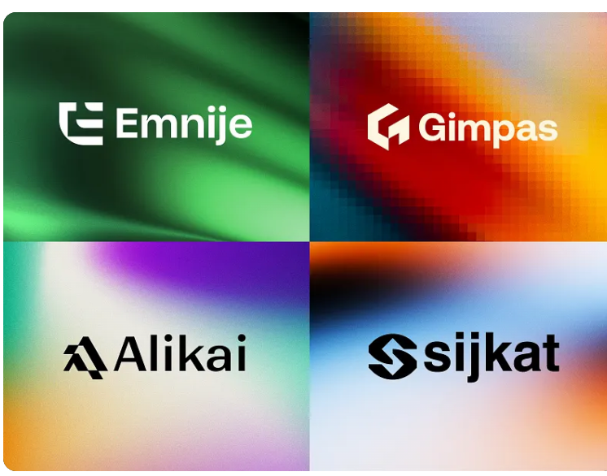
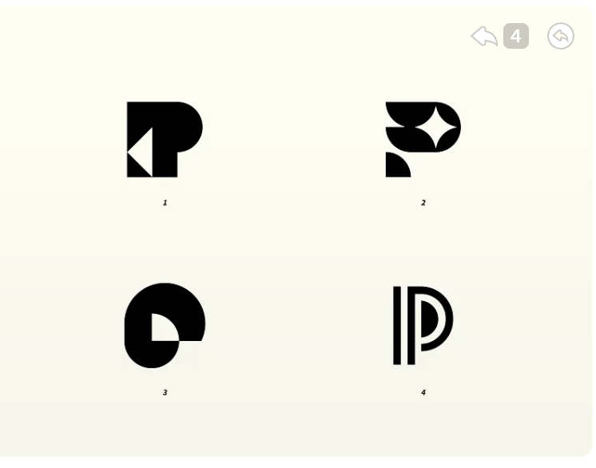

# hololocal — logo designer handoff

## Product

hololocal is a local AI assistant. It can chat and operate a browser or desktop inside an isolated virtual machine.
The interface is minimal, with dark and light themes, rounded controls, and a purple/pink input glow.

## Design direction

Create a distinctive brand mark and a clean hololocal wordmark.
The user likes the existing serif “h”, but wants a more original identity.
Explore balanced curves, geometric construction, and deliberate cutouts or negative space.
An “h” or “hl” direction is welcome, but should feel custom rather than like a standard letter.
Avoid a detached decorative dot. Earlier h and hl concepts were not approved.
Use the reference images for direction. Do not copy an existing logo.

Holo's friendly chat avatar is a separate character. This brief concerns the brand logo, not that avatar.
The mark must work without gradients, glow, or colour.

## Deliverables

- An original symbol and a matching hololocal wordmark.
- Horizontal and symbol-only versions.
- Light and dark versions, with transparent backgrounds.
- Editable vector source and SVG exports.
- Small-size previews at 16, 24, and 32 pixels, plus favicon exports.
- A short explanation of the chosen geometry, spacing, and typeface.

Show the user the concepts before choosing a final direction. No current draft is the approved logo.

## Original reference images

These seven images were supplied by the user on 11 November 2026.
They are inspiration references, not final assets or licensed marks for reuse.
The archive preserves the original image files without resizing them.

### 01 — Monochrome symbols

Bold silhouettes, geometric construction, and strong negative space.

### 02 — Organic and geometric symbols

Balanced curves, radial forms, and symbols that remain readable in one colour.

### 03 — Colour symbol grid

Distinctive compact marks. The final hololocal mark must also work in monochrome.

### 04 — Logo database examples

Letter construction, cutouts, and compact arrangements.

### 05 — Bold marks and wordmarks

Examples of a symbol paired with clear typography.

### 06 — Geometric marks on gradient backgrounds

Consider the mark and wordmark separately from the background effects.

### 07 — Rounded letterforms and cutouts

The user's final added reference: simple curves and purposeful openings.

